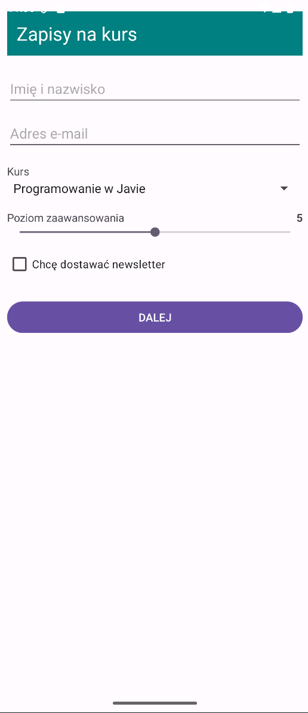
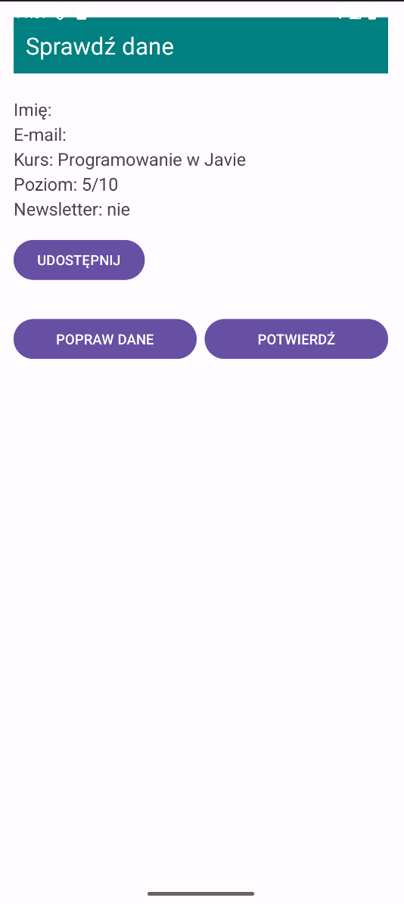

# Aplikacja Android - dwa ekrany

## Opis

Projekt przedstawia prostą aplikację do zapisywania się na kurs. Użytkownik wypełnia formularz na pierwszym ekranie, a następnie przechodzi do podsumowania, gdzie może sprawdzić podane informacje i potwierdzić zgłoszenie.

Dane pomiędzy ekranami są przekazywane za pomocą `Intent` i `putExtra()`.

## Funkcje aplikacji

- Wypełnianie formularza zapisu na kurs.
- Wybór kursu z listy.
- Ustawienie poziomu zaawansowania za pomocą `SeekBar`.
- Zaznaczenie zgody na newsletter.
- Przekazanie danych na drugi ekran.
- Wyświetlenie podsumowania.
- Potwierdzenie zgłoszenia i otrzymanie numeru.
- Powrót do formularza bez potwierdzania.
- Udostępnienie podsumowania przez inną aplikację.

## Zrzuty ekranu

### Ekran formularza

Na pierwszym ekranie użytkownik podaje swoje dane, wybiera kurs i określa poziom zaawansowania. Po kliknięciu przycisku "DALEJ" aplikacja otwiera ekran podsumowania.

### Ekran podsumowania

Drugi ekran wyświetla dane z formularza. Można tutaj wrócić do edycji, potwierdzić zgłoszenie lub udostępnić podsumowanie.

## Odpowiedzi na pytania

### 1. Dlaczego rejestracja wyniku znajduje się w polu klasy?

`ActivityResultLauncher` musi zostać zarejestrowany przed uruchomieniem aktywności. Dzięki temu Android może obsłużyć wynik również wtedy, gdy pierwsza aktywność zostanie zniszczona i ponownie utworzona. Gdyby rejestracja znajdowała się wewnątrz obsługi kliknięcia przycisku, mogłoby dojść do błędu związanego z cyklem życia aktywności.

### 2. Co zobaczy pierwszy ekran po naciśnięciu przycisku Wstecz?

Po naciśnięciu Wstecz aplikacja zamyka drugi ekran i wraca do formularza. Wprowadzone wcześniej dane pozostają na swoich miejscach. Pierwsza aktywność otrzymuje `RESULT_CANCELED`, ponieważ użytkownik nie potwierdził zgłoszenia.

## Wykorzystane technologie

- Java
- Android Studio
- XML
- Android SDK

## Struktura projektu

- `MainActivity.java` - obsługa formularza.
- `SummaryActivity.java` - obsługa podsumowania i zwracania wyniku.
- `activity_main.xml` - wygląd pierwszego ekranu.
- `activity_summary.xml` - wygląd drugiego ekranu.
- `strings.xml` - teksty używane w aplikacji.
- `AndroidManifest.xml` - deklaracje aktywności.

## Autor

Projekt wykonany w ramach zajęć z aplikacji mobilnych.