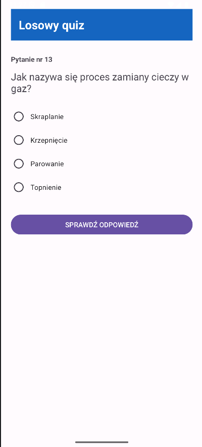

# Quiz

Prosta aplikacja Android z losowymi pytaniami jednokrotnego wyboru. Po wybraniu odpowiedzi użytkownik od razu widzi wynik oraz poprawną odpowiedź, a następnie może rozpocząć kolejne pytanie lub udostępnić rezultat.

## Co robi aplikacja

- Wczytuje bank pytań z pliku JSON.
- Losuje pytania tak, aby nie powtarzały się przed przejściem całej puli.
- Pozwala wybrać jedną z czterech odpowiedzi.
- Informuje o poprawnej lub błędnej odpowiedzi i przyznaje 1 punkt za poprawną odpowiedź.
- Wyświetla poprawną odpowiedź po każdym pytaniu.
- Umożliwia rozpoczęcie następnej rundy oraz udostępnienie wyniku przez inne aplikacje Androida.

## Ekrany

### Quiz



Na ekranie głównym wyświetlane są numer pytania, jego treść i dostępne odpowiedzi. Po użyciu przycisku **SPRAWDŹ ODPOWIEDŹ** aplikacja sprawdza zaznaczoną opcję; brak wyboru powoduje wyświetlenie krótkiego komunikatu.

### Wynik


Drugi ekran pokazuje rezultat i właściwą odpowiedź. Z tego miejsca można udostępnić wynik albo wrócić do losowania następnego pytania.

## Pytania

Pytania znajdują się w pliku [`app/src/main/res/raw/questions.json`](app/src/main/res/raw/questions.json). Każdy wpis ma następującą postać:

```json
{
  "q": "Treść pytania",
  "a": "Odpowiedź A",
  "b": "Odpowiedź B",
  "c": "Odpowiedź C",
  "d": "Odpowiedź D",
  "correct_answer": "b"
}
```

Pole `correct_answer` wskazuje literę poprawnej odpowiedzi: `a`, `b`, `c` lub `d`.

## Technologie

- Java 11
- Android SDK (minSdk 24, targetSdk 37)
- AndroidX AppCompat i Activity Result API
- Material Components
- XML dla interfejsu
- JSON jako źródło pytań
